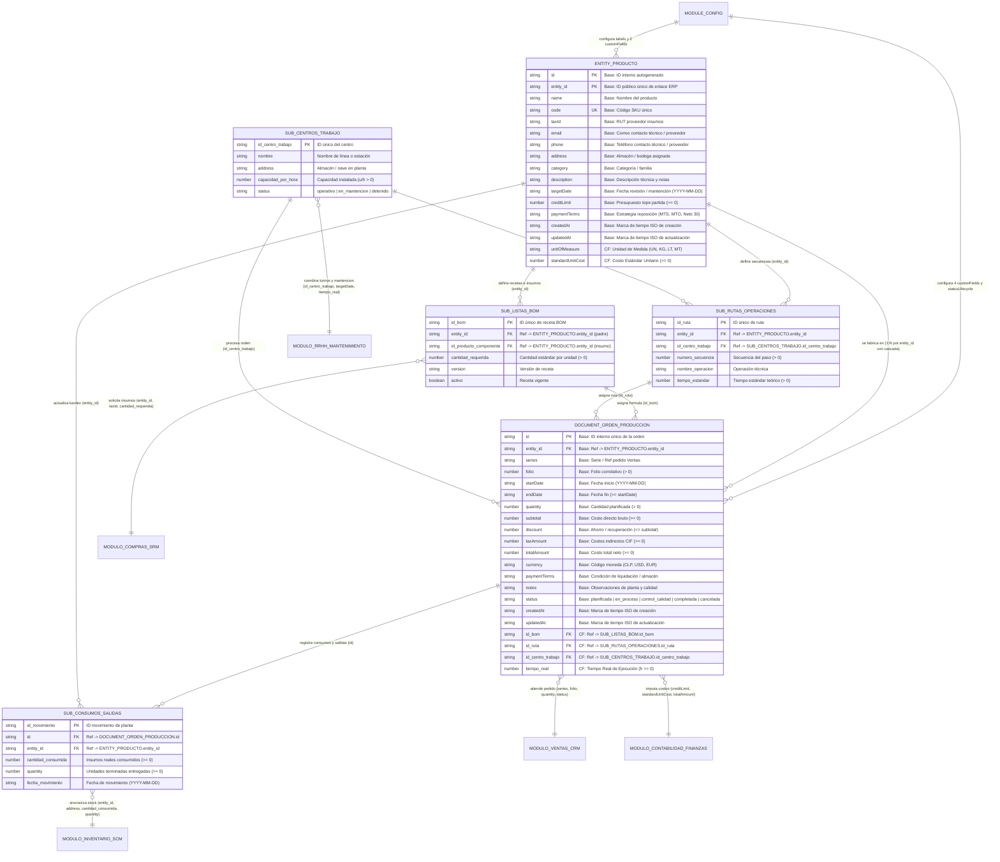
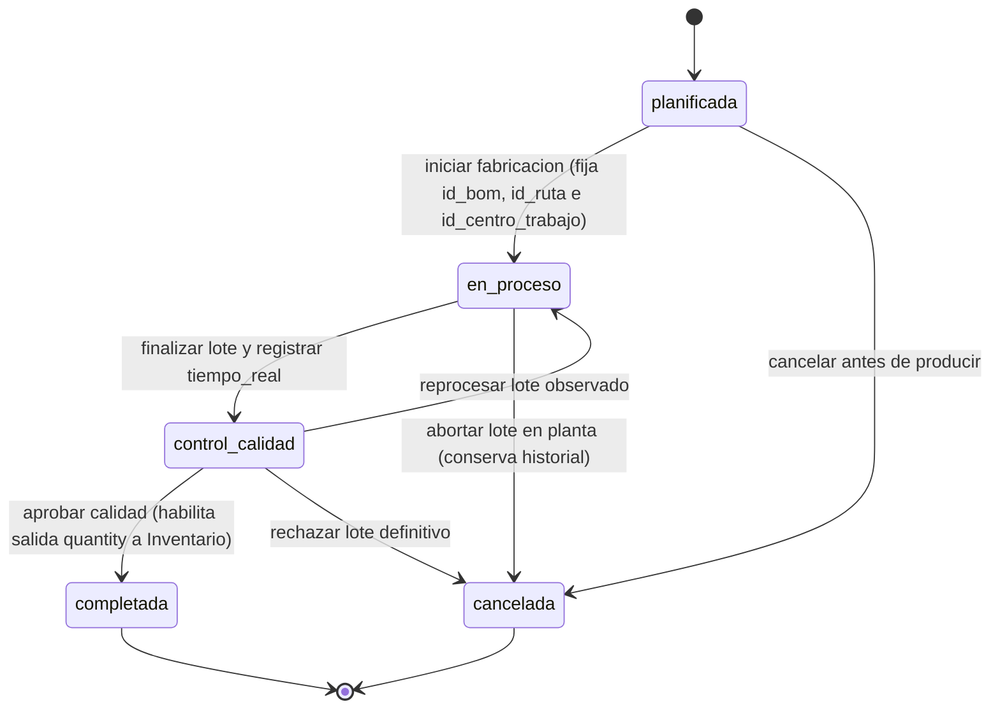
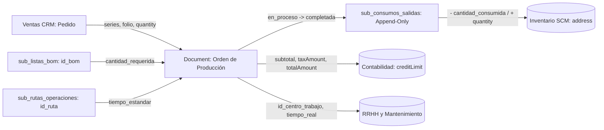

# Modelo de Datos: Módulo Base de Software de Planificación de Recursos Empresariales (ERP) — Manufactura y Operaciones (Grupo 15)

**Repositorio Oficial**: [`https://github.com/MDS-BI/Grupo-15`](https://github.com/MDS-BI/Grupo-15) | **Rama**: `001-erp-base-module`

Este modelo de datos formaliza el esquema lógico general del módulo de **Manufactura y Operaciones** sobre el módulo base (`001-erp-base-module`), estructurado en tres niveles de prioridad:
1. **Prioridad 1 — Núcleo Base del Template (`Entity`, `Document` y `ModuleConfig`)**: Conserva los 15 campos base de `Entity` (**Producto**) y los 17 campos base de `Document` (**Orden de Producción**) en `localStorage`, incorporando únicamente **6 campos personalizados (`customFields`)** que actúan como llaves foráneas y variables de control industrial.
2. **Prioridad 2 — Sub-Entidades Modulares de Manufactura en 3FN**: Desacopla las relaciones `1:N` en **4 sub-entidades normalizadas** (`sub_listas_bom`, `sub_rutas_operaciones`, `sub_centros_trabajo` y `sub_consumos_salidas`), visualizadas en un resumen ligero de solo lectura dentro del Panel y del detalle de Orden sin alterar las 4 vistas de la plantilla.
3. **Prioridad 3 — Contratos de Interconexión Empresarial**: Conecta en sesión local con **5 áreas de la empresa** (**Ventas y Comercial**, **Inventario y Bodega**, **Compras y Proveedores**, **Contabilidad y Finanzas**, y **RRHH y Mantenimiento**) utilizando exactamente las mismas variables compartidas.

## 0. Trazabilidad con el Enunciado y Estrategia de Mapeo sobre la Base 001

### 0.1 Tabla de Trazabilidad del Enunciado al Modelo

Cada requerimiento funcional descrito en `README.md` ([https://github.com/MDS-BI/Grupo-15/blob/main/README.md](https://www.google.com/search?q=https://github.com/MDS-BI/Grupo-15/blob/main/README.md)) se corresponde con una entidad, variable o regla de validación de este modelo:

| Enunciado Funcional (`README.md`) | Entidad, Variable (`key`) o Regla en `data-model.md` |
| :--- | :--- |
| «Cada producto se identifica por un código SKU único, su nombre y su categoría (terminado, subensamble o materia prima)» | `Entity.code` (`UK` obligatorio), `Entity.name`, `Entity.category` (§1.1) |
| «Define su unidad física estándar, su costo estándar unitario, su almacén asignado y su tope presupuestario» | `Entity.unitOfMeasure` (`CF`), `Entity.standardUnitCost` (`CF`), `Entity.address`, `Entity.creditLimit` (§1.1) |
| «Cada lista de materiales se versiona, tiene vigencia y solo mantiene una receta activa por producto para nuevas órdenes» | `sub_listas_bom.id_bom`, `.version`, `.activo` + `Entity.targetDate` (§2.1 y §5.4) |
| «Las líneas de receta señalan el insumo requerido y su cantidad por unidad, impidiendo referencias cíclicas a sí mismo» | `sub_listas_bom.id_producto_componente`, `.cantidad_requerida` + invariante anticiclos (§2.1 y §5.4) |
| «Las rutas definen la secuencia de operaciones, el centro de trabajo asignado y el tiempo estándar teórico» | `sub_rutas_operaciones.id_ruta`, `.numero_secuencia`, `.nombre_operacion`, `.tiempo_estandar`, `.id_centro_trabajo` (§2.2) |
| «Cada orden de producción se identifica por serie y folio, pertenece a un producto y fija la receta, ruta y centro al ejecutarse» | `Document.series`, `.folio`, `.entity_id`, `.id_bom` (`CF`), `.id_ruta` (`CF`), `.id_centro_trabajo` (`CF`) (§1.2) |
| «Registra fechas de inicio y fin (`endDate >= startDate`), cantidad planificada, costos y tiempo real ejecutado» | `Document.startDate`, `.endDate`, `.quantity`, `.subtotal`, `.discount`, `.taxAmount`, `.totalAmount`, `.tiempo_real` (`CF`) (§1.2) |
| «Avanza por los estados planificada, en_proceso, control_calidad, completada y cancelada» | `Document.status` gobernado por `ModuleConfig.statusLifecycle` (§1.3 y §4.2) |
| «Los movimientos de consumo y salida en planta son inmutables (append-only) y mantienen la cuadratura de stock» | `sub_consumos_salidas.id_movimiento`, `.cantidad_consumida`, `.quantity`, `.fecha_movimiento` (§2.4 y §5.4) |
| «Conecta horizontalmente con Ventas, Inventario, Compras, Contabilidad y RRHH/Mantenimiento» | Contratos de Prioridad 3 (§3) |
| «MRP automático multinivel, reservas finitas por minuto y trazabilidad por serie quedan fuera de alcance del MVP» | §6 **Fuera de Alcance (Out of Scope)** |

### 0.2 Estrategia de Mapeo sobre la Base 001

| Concepto de Manufactura y Operaciones | Mapeo en la Arquitectura Frontend | Justificación Metodológica y de Escalabilidad |
| :--- | :--- | :--- |
| **Producto (`Producto`)** | **`Entity` (Base 001)** + 2 `customFields` (`unitOfMeasure`, `standardUnitCost`) | Reutiliza el CRUD maestro, la clave pública `entity_id`, la búsqueda instantánea y el borrado en cascada de `src/storage.js` en `erp_base_module:entities`. |
| **Orden de Producción (`Orden de Producción`)** | **`Document` (Base 001)** + 4 `customFields` (`id_bom`, `id_ruta`, `id_centro_trabajo`, `tiempo_real`) + `statusLifecycle` | Aprovecha la numeración `series`/`folio`, el desglose económico (`subtotal`, `discount`, `taxAmount`, `totalAmount`) y el control de estados en `erp_base_module:documents`. |
| **Recetas BOM, Rutas, Centros y Movimientos** | **4 Sub-Entidades en 3FN** (`sub_listas_bom`, `sub_rutas_operaciones`, `sub_centros_trabajo`, `sub_consumos_salidas`) | Desacopla datos relacionales `1:N` fuera de los formularios principales, permitiendo escalar a claves particionadas en `localStorage` (`erp_base_module:sub:*`) y mostrarlos en un resumen de solo lectura en el Panel y detalle de Orden. |
| **Integración con 5 Áreas de la Empresa** | **Contratos de Variables Compartidas** | Permite que Ventas, Inventario, Compras, Contabilidad y RRHH consuman los mismos objetos JSON en sesión local sin renombrar campos. |

## 1. Prioridad 1: Entidades Principales Base (Persistidas en `src/storage.js`)

### 1.1 Entidad: `Entity` (Registro de Datos Maestros — `Producto`)

Representa un **Producto** (artículo terminado, subensamble o materia prima) dentro del padrón maestro del módulo, almacenado en `localStorage` bajo la clave `erp_base_module:entities`.

| Campo | Tipo | Descripción | Restricciones |
| :--- | :--- | :--- | :--- |
| `id` | `string` | Identificador interno único del registro de entidad (`PK` interna). | Obligatorio, generado automáticamente, único |
| `entity_id` | `string` | Identificador público único usado para vincular `Órdenes de Producción`, sub-entidades y módulos empresariales a este `Producto` (`PK` pública). | Obligatorio, generado automáticamente, único |
| `name` | `string` | Nombre comercial o técnico del producto manufacturado o insumo. | Obligatorio, no vacío, texto recortado y sanitizado |
| `code` | `string` | Código SKU o clave de negocio única que identifica al `Producto` en toda la empresa (`UK`). | Obligatorio, no vacío, único, texto recortado |
| `taxId` | `string` | Identificación fiscal (RUT/NIT) del proveedor principal de insumos críticos (conecta con Compras). | Opcional; se almacena recortada cuando se proporciona |
| `email` | `string` | Correo electrónico principal del ingeniero responsable del producto o contacto del proveedor. | Opcional; debe cumplir formato `^[^\s@]+@[^\s@]+\.[^\s@]+$` |
| `phone` | `string` | Teléfono o anexo de contacto operativo del área de ingeniería o proveedor. | Opcional; se almacena recortado |
| `address` | `string` | Almacén o bodega principal asignada al producto en planta (compartido con Inventario y `sub_centros_trabajo`). | Opcional; se almacena recortada |
| `category` | `string` | Clasificación o familia industrial (`"Producto Terminado"`, `"Subensamble"`, `"Materia Prima"`). | Opcional; se almacena recortada |
| `description` | `string` | Descripción técnica general, especificaciones de calidad y notas de ingeniería del producto. | Opcional; texto recortado y sanitizado |
| `targetDate` | `string` | Fecha objetivo de vigencia técnica de la receta o próxima revisión/mantención programada. | Opcional; formato `YYYY-MM-DD` (`^\d{4}-\d{2}-\d{2}$`), fecha de calendario válida |
| `creditLimit` | `number` | Presupuesto operativo máximo o límite de costo asignado a la partida del producto en la moneda configurada. | Opcional; número finito no negativo (`>= 0`) |
| `paymentTerms` | `string` | Estrategia operativa de reposición o condición comercial acordada (`"MTS"`, `"MTO"`, `"Neto 30"`). | Opcional; se almacena recortada |
| `createdAt` | `string` | Marca de tiempo ISO 8601 de creación del registro del `Producto`. | Obligatorio, generado automáticamente |
| `updatedAt` | `string` | Marca de tiempo ISO 8601 de la última actualización del `Producto`. | Obligatorio, generado automáticamente |

#### Campos Personalizados de `Entity` declarados en `ModuleConfig` (`target: "entity"`)

| Campo | Tipo | Descripción | Restricciones |
| :--- | :--- | :--- | :--- |
| `unitOfMeasure` | `string` (`select`) | Define la unidad física estándar en la que se cuantifica, inventaría y fabrica el producto en toda la empresa (`label: "Unidad de Medida"`). | Obligatorio; valor perteneciente a `["UN", "KG", "LT", "MT"]` |
| `standardUnitCost` | `number` | Representa el costo teórico unitario de fabricación del producto, utilizado como referencia base para valorizar inventarios y medir desviaciones en Contabilidad (`label: "Costo Estándar Unitario"`). | Obligatorio; número finito no negativo (`>= 0`) |

### 1.2 Entidad: `Document` (Registro Transaccional — `Orden de Producción`)

Representa una **Orden de Producción** vinculada a un `Producto` mediante `entity_id`, almacenada en `localStorage` bajo la clave `erp_base_module:documents`.

| Campo | Tipo | Descripción | Restricciones |
| :--- | :--- | :--- | :--- |
| `id` | `string` | Identificador único interno de la `Orden de Producción` (`PK` interna). | Obligatorio, generado automáticamente, único |
| `entity_id` | `string` | Identificador del `Producto` que se fabrica en esta orden (`FK` → `Entity.entity_id`). | Obligatorio; debe referenciar el `entity_id` de un `Entity` existente |
| `series` | `string` | Serie documental de la orden (p. ej., `"OP"`, `"OF"`), usada también para referenciar el pedido de origen en Ventas. | Opcional; cadena recortada |
| `folio` | `number` | Folio consecutivo oficial que junto con `series` forma el número visible del documento (p. ej., `OP-1001`). | Obligatorio; número entero positivo (`> 0`) |
| `startDate` | `string` | Fecha programada o real de inicio de fabricación del lote. | Obligatorio; formato `YYYY-MM-DD` (`^\d{4}-\d{2}-\d{2}$`), fecha de calendario válida |
| `endDate` | `string` | Fecha programada o real de fin de fabricación y entrega a bodega. | Obligatorio; formato `YYYY-MM-DD` válido y debe cumplir `endDate >= startDate` |
| `quantity` | `number` | Cantidad planificada de unidades a fabricar en la orden. | Opcional en base (requerido en operación); número entero positivo (`> 0`) |
| `subtotal` | `number` | Costo directo bruto del lote antes de descuentos e impuestos (materiales + horas de operación). | Opcional; número finito no negativo (`>= 0`) |
| `discount` | `number` | Ahorro por eficiencia operativa o crédito por recuperación de subproductos/mermas. | Opcional; número finito no negativo (`>= 0`) y debe cumplir `discount <= subtotal` |
| `taxAmount` | `number` | Costos indirectos de fabricación (CIF) o cargos/impuestos aplicables al lote. | Opcional; número finito no negativo (`>= 0`) |
| `totalAmount` | `number` | Costo total neto de la `Orden de Producción` en la moneda configurada (`subtotal - discount + taxAmount`). | Opcional; número finito no negativo (`>= 0`) |
| `currency` | `string` | Código ISO de moneda para los importes de la orden (`"CLP"`, `"USD"`, `"EUR"`). | Opcional; cadena recortada |
| `paymentTerms` | `string` | Condición de liquidación contable o almacén receptor del lote terminado. | Opcional; cadena recortada |
| `notes` | `string` | Observaciones de ejecución en planta, consumo de materiales y dictamen de control de calidad. | Opcional; texto recortado y sanitizado |
| `status` | `string` | Estado actual de la orden dentro del flujo productivo gobernado por `statusLifecycle`. | Controlado por `ModuleConfig.statusLifecycle`: `["planificada", "en_proceso", "control_calidad", "completada", "cancelada"]` |
| `createdAt` | `string` | Marca de tiempo ISO 8601 de creación de la `Orden de Producción`. | Obligatorio, generado automáticamente |
| `updatedAt` | `string` | Marca de tiempo ISO 8601 de la última actualización de la `Orden de Producción`. | Obligatorio, generado automáticamente |

#### Campos Personalizados de `Document` declarados en `ModuleConfig` (`target: "document"`)

| Campo | Tipo | Descripción | Restricciones |
| :--- | :--- | :--- | :--- |
| `id_bom` | `string` (`text`) | Llave foránea hacia la receta activa en `sub_listas_bom.id_bom` (p. ej., `"BOM-001-V1"`) con la que se fabrica el lote (`label: "ID Lista de Materiales (BOM)"`). | Obligatorio, no vacío, texto recortado y sanitizado |
| `id_ruta` | `string` (`text`) | Llave foránea hacia la secuencia de fabricación en `sub_rutas_operaciones.id_ruta` (p. ej., `"RUTA-ENS-01"`) aplicada a la orden (`label: "ID Ruta de Producción"`). | Obligatorio, no vacío, texto recortado y sanitizado |
| `id_centro_trabajo` | `string` (`select`) | Llave foránea hacia la estación o línea principal en `sub_centros_trabajo.id_centro_trabajo` responsable de la ejecución (`label: "ID Centro de Trabajo"`). | Obligatorio; valor perteneciente a `["CT-01 Ensamble", "CT-02 Maquinado", "CT-03 Procesos", "CT-04 Empaque"]` |
| `tiempo_real` | `number` | Total de horas reales empleadas en ejecutar la orden en planta, utilizado para medir eficiencia frente a `tiempo_estandar` y reportar horas a RRHH/Costos (`label: "Tiempo Real de Ejecución (h)"`). | Obligatorio; número finito no negativo (`>= 0`) |

### 1.3 Entidad: `ModuleConfig` (`src/module-config.js`)

| Campo | Tipo | Descripción | Restricciones |
| :--- | :--- | :--- | :--- |
| `moduleName` | `string` | Nombre visible del módulo adaptado: `"Manufactura y Operaciones"`. | Obligatorio, no vacío |
| `labels` | `object` | Mapeo de términos: `{ entity: "Producto", entities: "Productos", document: "Orden de Producción", documents: "Órdenes de Producción" }`. | Opcional; retrocede a `Entidad`/`Documento` |
| `customFields` | `array` | Arreglo con los 6 descriptores de campos personalizados (`unitOfMeasure`, `standardUnitCost`, `id_bom`, `id_ruta`, `id_centro_trabajo`, `tiempo_real`). | Opcional; las claves `key` NO DEBEN chocar con los 32 nombres de campos base |
| `statusLifecycle` | `object` | Define `statuses: ["planificada", "en_proceso", "control_calidad", "completada", "cancelada"]` y el mapa dirigido de `transitions`. | Opcional; reemplaza la entrada libre de `status` |
| `theme` | `object` | Opciones de marca: `{ accentColor: "#d97706" }`, inyectado como propiedad CSS `--accent` en el marco de trabajo. | Opcional; color hexadecimal CSS válido (`#rgb` o `#rrggbb`) o retrocede a `#2563eb` |

## 2. Prioridad 2: Sub-Entidades Modulares de Manufactura en 3FN (Escalabilidad Interna)

Para evitar redundancia y mantener las entidades principales en Tercera Forma Normal (3FN), los detalles `1:N` de ingeniería y piso de planta se especifican en **4 sub-entidades tabulares** almacenables bajo `erp_base_module:sub:*` en `localStorage`:

### 2.1 Sub-Entidad 1: `sub_listas_bom` (Recetas y Componentes de Materiales)

Almacena las versiones de listas de materiales de cada producto y los insumos requeridos por unidad (`erp_base_module:sub:listas_bom`).

| Campo | Tipo | Descripción | Restricciones |
| :--- | :--- | :--- | :--- |
| `id_bom` | `string` | Identificador único de la receta o lista de materiales (`PK`, referenciado por `Document.id_bom`). | Obligatorio, no vacío, único por versión/línea |
| `entity_id` | `string` | Identificador del `Producto` terminado o subensamble padre (`FK` → `Entity.entity_id`). | Obligatorio; debe existir en `Entity` |
| `id_producto_componente` | `string` | Identificador del insumo o materia prima requerida (`FK` → `Entity.entity_id`). | Obligatorio; debe existir en `Entity` y cumplir `id_producto_componente !== entity_id` (sin ciclos) |
| `cantidad_requerida` | `number` | Cantidad estándar de insumo necesaria por cada unidad de producto padre a fabricar. | Obligatorio; número finito positivo (`> 0`) |
| `version` | `string` | Código de revisión técnica de la fórmula (p. ej., `"v1.0"`, `"v2.0"`). | Obligatorio, no vacío |
| `activo` | `boolean` | Indica si la versión de la receta se encuentra vigente para nuevas órdenes. | Obligatorio; solo una versión `activo === true` simultánea por `entity_id` |

### 2.2 Sub-Entidad 2: `sub_rutas_operaciones` (Rutas de Fabricación y Secuencias Estándar)

Define la secuencia ordenada de operaciones técnicas y sus tiempos teóricos por producto (`erp_base_module:sub:rutas_operaciones`).

| Campo | Tipo | Descripción | Restricciones |
| :--- | :--- | :--- | :--- |
| `id_ruta` | `string` | Identificador único de la hoja de ruta de producción (`PK`, referenciado por `Document.id_ruta`). | Obligatorio, no vacío, único por secuencia |
| `entity_id` | `string` | Identificador del `Producto` cuya secuencia tecnológica se define (`FK` → `Entity.entity_id`). | Obligatorio; debe existir en `Entity` |
| `id_centro_trabajo` | `string` | Identificador de la estación donde se ejecuta la operación (`FK` → `sub_centros_trabajo.id_centro_trabajo`). | Obligatorio; debe existir en `sub_centros_trabajo` |
| `numero_secuencia` | `number` | Orden correlativo del paso dentro de la ruta (p. ej., `10`, `20`, `30`). | Obligatorio; número entero positivo (`> 0`) |
| `nombre_operacion` | `string` | Descripción técnica del proceso productivo (p. ej., `"Corte CNC"`, `"Ensamble"`, `"Pruebas"`). | Obligatorio, no vacío, texto sanitizado |
| `tiempo_estandar` | `number` | Tiempo teórico estándar en horas requerido por unidad en esta operación. | Obligatorio; número finito positivo (`> 0`) |

### 2.3 Sub-Entidad 3: `sub_centros_trabajo` (Maestro de Estaciones y Capacidad de Planta en 3FN)

Representa el catálogo maestro de líneas, celdas y estaciones de trabajo con su capacidad instalada (`erp_base_module:sub:centros_trabajo`), libre de dependencias transitivas o inversas hacia documentos.

| Campo | Tipo | Descripción | Restricciones |
| :--- | :--- | :--- | :--- |
| `id_centro_trabajo` | `string` | Identificador único del centro o estación de trabajo (`PK`, referenciado por `Document.id_centro_trabajo` y `sub_rutas_operaciones.id_centro_trabajo`). | Obligatorio, no vacío, único |
| `nombre` | `string` | Nombre descriptivo de la estación, celda o línea de producción (p. ej., `"CT-01 Ensamble"`). | Obligatorio, no vacío, texto sanitizado |
| `address` | `string` | Nave industrial o almacén físico donde se ubica la estación (compartido semánticamente con `Entity.address`). | Opcional; cadena recortada |
| `capacidad_por_hora` | `number` | Capacidad productiva nominal instalada medida en unidades por hora (`u/h`). | Obligatorio; número finito positivo (`> 0`) |
| `status` | `string` | Estado operativo actual de la estación en planta (`"operativo"`, `"en_mantencion"`, `"detenido"`). | Obligatorio; valor controlado en `["operativo", "en_mantencion", "detenido"]` |

### 2.4 Sub-Entidad 4: `sub_consumos_salidas` (Movimientos de Materiales y Producto Terminado — Journal Inmutable)

Registra de forma inmutable (*append-only*) los consumos de materias primas y las entregas de producto terminado generados por cada orden (`erp_base_module:sub:consumos_salidas`).

| Campo | Tipo | Descripción | Restricciones |
| :--- | :--- | :--- | :--- |
| `id_movimiento` | `string` | Identificador único del asiento de movimiento de planta (`PK`). | Obligatorio, generado automáticamente, único |
| `id` | `string` | Identificador de la `Orden de Producción` que origina el movimiento (`FK` → `Document.id`). | Obligatorio; debe existir en `Document` |
| `entity_id` | `string` | Identificador del insumo consumido o del producto terminado entregado (`FK` → `Entity.entity_id`). | Obligatorio; debe existir en `Entity` |
| `cantidad_consumida` | `number` | Cantidad real de materia prima descargada de inventario e incorporada al lote. | Obligatorio; número finito no negativo (`>= 0`) |
| `quantity` | `number` | Cantidad de unidades terminadas aprobadas que ingresan a bodega al completar la orden. | Obligatorio; número entero no negativo (`>= 0`) |
| `fecha_movimiento` | `string` | Fecha efectiva del consumo o entrega en formato `YYYY-MM-DD`. | Obligatorio; formato `^\d{4}-\d{2}-\d{2}$` válido |

## 3. Prioridad 3: Contratos de Interconexión con los 5 Módulos de Otras Áreas de la Empresa

| Área Empresarial del ERP | Entidades de Manufactura Vinculadas | Llaves y Variables Compartidas (Mismo Nombre y Tipo) | Regla de Integración en Sesión Local (`localStorage`) |
| :--- | :--- | :--- | :--- |
| **1. Módulo de Ventas y Comercial (CRM)** | `Entity` y `Document` | `entity_id`, `code`, `series`, `folio`, `quantity`, `startDate`, `endDate`, `status` | Los pedidos de clientes referencian `entity_id`/`code` y consultan el avance (`status`) y fecha de entrega (`endDate`) de la orden `series`-`folio`. |
| **2. Módulo de Inventario y Bodega (SCM)** | `Entity`, `sub_centros_trabajo` y `sub_consumos_salidas` | `entity_id`, `code`, `address`, `unitOfMeasure`, `cantidad_consumida`, `quantity` | Descuenta del almacén (`address`) la `cantidad_consumida` de insumos y suma al stock disponible las unidades terminadas (`quantity`) cuando `status === "completada"`. |
| **3. Módulo de Compras y Proveedores (SRM)** | `Entity` y `sub_listas_bom` | `entity_id`, `code`, `id_bom`, `cantidad_requerida`, `taxId`, `email`, `phone`, `paymentTerms`, `targetDate` | Calcula el requerimiento bruto de materiales (`cantidad_requerida * quantity`) y enlaza con el proveedor registrado en `taxId`, `email` y `phone`. |
| **4. Módulo de Contabilidad y Finanzas** | `Entity` y `Document` | `entity_id`, `series`, `folio`, `creditLimit`, `standardUnitCost`, `subtotal`, `discount`, `taxAmount`, `totalAmount`, `currency` | Contrasta el presupuesto tope (`creditLimit`) y el `standardUnitCost` frente al costo real liquidado en la orden (`subtotal - discount + taxAmount = totalAmount`). |
| **5. Módulo de RRHH y Mantenimiento (EAM)** | `Entity`, `Document`, `sub_centros_trabajo` y `sub_rutas_operaciones` | `id_centro_trabajo`, `tiempo_estandar`, `tiempo_real`, `capacidad_por_hora`, `targetDate`, `status` | Evalúa la productividad por turno (`tiempo_estandar` vs `tiempo_real`) y programa mantenciones preventivas según `targetDate` y `sub_centros_trabajo.status`. |

## 4. Apartado del Modelo Entidad-Relación (MER) y Diagramas de Comportamiento

### 4.1 Diagrama Entidad-Relación (`erDiagram` con el 100% de los Atributos)

Su representación gráfica de alta resolución se encuentra en el archivo `mer_manufactura_operaciones.png` en la raíz del proyecto ([https://github.com/MDS-BI/Grupo-15/blob/main/mer\_manufactura\_operaciones.png](https://www.google.com/search?q=https://github.com/MDS-BI/Grupo-15/blob/main/mer_manufactura_operaciones.png)).

### 4.2 Máquina de Estados — Orden de Producción (`statusLifecycle`)

### 4.3 Flujo Operativo de Movimientos e Integración ERP

## 5. Reglas de Integridad, Validación y Extensibilidad

### 5.1 Reglas de `ModuleConfig` y No Colisión
- La configuración se carga una vez al arrancar desde `src/module-config.js` y se aplica en todas las pantallas.
- Las claves de `customFields` (`unitOfMeasure`, `standardUnitCost`, `id_bom`, `id_ruta`, `id_centro_trabajo`, `tiempo_real`) tienen prohibido chocar con los 32 nombres de campos base (`id`, `entity_id`, `name`, `code`, `taxId`, `email`, `phone`, `address`, `category`, `description`, `targetDate`, `creditLimit`, `paymentTerms`, `series`, `folio`, `startDate`, `endDate`, `quantity`, `subtotal`, `discount`, `taxAmount`, `totalAmount`, `currency`, `notes`, `status`, `createdAt`, `updatedAt`).
- Ante cualquier valor de configuración inválido, el sistema informa el error en un banner visible y retrocede de forma segura a los valores predeterminados (`DEFAULT_CONFIG`).

### 5.2 Reglas de Validación sobre `Entity` (`Producto`)
- `name` y `code` son obligatorios y no pueden ser cadenas vacías tras aplicar `trim()`.
- `entity_id` se genera automáticamente y es único en `erp_base_module:entities`.
- `email`, cuando está presente, debe cumplir la expresión regular `^[^\s@]+@[^\s@]+\.[^\s@]+$`.
- `creditLimit`, cuando está presente, debe ser un número finito no negativo (`>= 0`).
- `targetDate`, cuando está presente, debe cumplir el formato `^\d{4}-\d{2}-\d{2}$` y representar una fecha de calendario válida.
- `unitOfMeasure` es obligatorio y debe pertenecer a `["UN", "KG", "LT", "MT"]`.
- `standardUnitCost` es obligatorio y debe ser un número finito no negativo (`>= 0`).

### 5.3 Reglas de Validación sobre `Document` (`Orden de Producción`)
- `entity_id` es obligatorio y debe referenciar el `entity_id` de un `Producto` existente en `erp_base_module:entities`.
- `folio` es obligatorio y debe ser un número entero positivo (`> 0`).
- `startDate` y `endDate` son obligatorias, deben cumplir `^\d{4}-\d{2}-\d{2}$` y satisfacer la desigualdad `endDate >= startDate`.
- `quantity`, cuando se proporciona, debe ser un número entero positivo (`> 0`).
- `subtotal`, `discount`, `taxAmount` y `totalAmount` deben ser números finitos no negativos (`>= 0`), cumpliendo obligatoriamente `discount <= subtotal`.
- `id_bom`, `id_ruta` e `id_centro_trabajo` son obligatorios y no vacíos; `tiempo_real` es obligatorio y no negativo (`>= 0`).
- `status` solo acepta valores de `statusLifecycle.statuses` y transiciones permitidas desde el estado actual.

### 5.4 Relaciones, Eliminación en Cascada e Invariantes Industriales
- **Relación `1:N` y Eliminación en Cascada**: Cada `Producto` (`Entity`) se conecta con cero o más `Órdenes de Producción` (`Document`) mediante `entity_id`. Al eliminar un `Producto` de `erp_base_module:entities`, `src/storage.js` elimina automáticamente en cascada todas las `Órdenes de Producción` asociadas en `erp_base_module:documents`.
- **Invariante 1 — Congelamiento de Receta y Ruta**: Al transicionar una `Orden de Producción` al estado `en_proceso`, quedan fijados sus identificadores `id_bom` e `id_ruta` para garantizar la trazabilidad histórica del lote.
- **Invariante 2 — Prohibición de Ciclos en BOM**: En `sub_listas_bom`, ningún `Producto` (`entity_id`) puede referenciarse a sí mismo como `id_producto_componente` (ni directa ni indirectamente).
- **Invariante 3 — Inmutabilidad de Movimientos (*Append-Only*)**: Los registros de `sub_consumos_salidas` no se editan ni eliminan; las correcciones de stock se ejecutan mediante movimientos compensatorios.

## 6. Fuera de Alcance (Out of Scope)

Los siguientes dominios quedan explícitamente fuera del alcance operativo del MVP inicial y se reservan para iteraciones posteriores conforme a la matriz de alcance de `specs/001-erp-base-module/plan.md` ([https://github.com/MDS-BI/Grupo-15/blob/main/specs/001-erp-base-module/plan.md](https://www.google.com/search?q=https://github.com/MDS-BI/Grupo-15/blob/main/specs/001-erp-base-module/plan.md)):
- **Ejecución automática de MRP multinivel** y emisión automatizada de órdenes de compra.
- **Programación de capacidad finita (CRP)** minuto a minuto y reservas bloqueantes de stock.
- **Tablas de factores de conversión cruzada entre unidades de medida o monedas**.
- **Trazabilidad unitaria por número de serie individual de pieza**.
- **Persistencia en servidor backend o motor de base de datos relacional externo** (el sistema opera 100% en `localStorage`).
