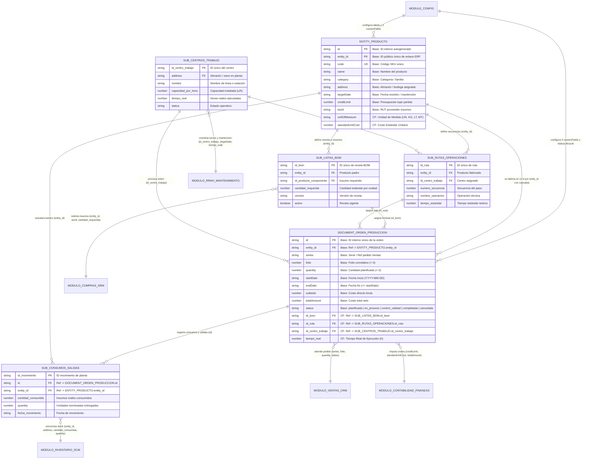

# Modelo de Datos: Módulo Base de Software de Planificación de Recursos Empresariales (ERP) — Manufactura y Operaciones

Este modelo de datos está diseñado de forma **modular y escalable en tres niveles de prioridad**:
1. **Prioridad 1 — Núcleo Base del Template (`Entity`, `Document` y `ModuleConfig`)**: Mantiene el 100% de las variables base del curso para asegurar compatibilidad inmediata en `localStorage`, reduciendo la carga de las entidades principales a solo **6 campos personalizados (`customFields`)** que funcionan como llaves foráneas y métricas resumen.
2. **Prioridad 2 — Sub-Entidades Modulares de Manufactura y Operaciones**: Organiza el detalle técnico e industrial en **4 sub-entidades cohesivas** (`sub_listas_bom`, `sub_rutas_operaciones`, `sub_centros_trabajo` y `sub_consumos_salidas`), evitando saturar `Entity` y `Document`.
3. **Prioridad 3 — Módulos de Otras Áreas de la Empresa Conectados**: Conecta el módulo de Manufactura y Operaciones con **5 áreas empresariales del ERP** (**Ventas y Comercial**, **Inventario y Bodega**, **Compras y Proveedores**, **Contabilidad y Finanzas**, y **RRHH y Mantenimiento**) utilizando exactamente las mismas variables compartidas.

## 1. Prioridad 1: Entidades Principales Base (Persistidas en `src/storage.js`)

### 1.1 Entidad: `Entity` (Registro de Datos Maestros — `Producto`)

Representa un **Producto** (artículo terminado, semielaborado o materia prima) dentro del padrón maestro del módulo (`erp_base_module:entities`).

| Campo | Tipo | Descripción Unificada en Manufactura e Integración Empresarial | Restricciones |
|---|---|---|---|
| `id` | `string` | Identificador interno único del registro de entidad, generado automáticamente. | Obligatorio, generado automáticamente |
| `entity_id` | `string` | Identificador público único autogenerado usado para vincular `Órdenes de Producción`, sub-entidades de manufactura y los demás módulos de la empresa a este `Producto`. | Obligatorio, generado automáticamente, único |
| `name` | `string` | Nombre comercial o técnico del producto manufacturado o insumo. | Obligatorio, no vacío |
| `code` | `string` | Código SKU o clave de negocio única que identifica al `Producto` en toda la empresa. | Obligatorio, no vacío |
| `category` | `string` | Categoría, tipo o familia industrial del producto (`"Producto Terminado"`, `"Subensamble"`, `"Materia Prima"`). | Opcional; cadena recortada |
| `description` | `string` | Descripción técnica general y notas de ingeniería del producto. | Opcional; cadena recortada |
| `address` | `string` | Almacén o bodega principal asignada al producto en planta (conecta con Inventario y Centros de Trabajo). | Opcional; cadena recortada |
| `targetDate` | `string` | Fecha objetivo (`YYYY-MM-DD`) de vigencia técnica de la receta o próxima revisión/mantención programada. | Opcional, fecha de calendario válida |
| `creditLimit` | `number` | Presupuesto operativo máximo o límite de costo asignado a la partida del producto en la moneda configurada (conecta con Contabilidad). | Opcional, número no negativo (`>= 0`) |
| `paymentTerms` | `string` | Estrategia operativa o condición comercial de reposición (`"MTS"`, `"MTO"`, `"Neto 30"`). | Opcional; cadena recortada |
| `taxId` | `string` | Identificación fiscal (RUT/NIT) del proveedor principal de insumos críticos (conecta con Compras). | Opcional; cadena recortada |
| `email` | `string` | Correo electrónico del responsable técnico o contacto del proveedor. | Opcional; formato de correo válido |
| `phone` | `string` | Teléfono o anexo de contacto operativo. | Opcional; cadena recortada |
| `createdAt` | `string` | Marca de tiempo de creación del registro del `Producto`. | Obligatorio |
| `updatedAt` | `string` | Marca de tiempo de la última actualización del `Producto`. | Obligatorio |

#### Campos Personalizados de `Entity` en `ModuleConfig` (`target: "entity"` — Solo 2 campos)

| Campo (`key`) | Etiqueta (`label`) | Tipo | Descripción Unificada | Restricciones |
|---|---|---|---|---|
| `unitOfMeasure` | `Unidad de Medida` | `select` | Define la unidad física estándar en la que se cuantifica, inventaría y fabrica el producto en toda la empresa. | Obligatorio; opciones: `["UN", "KG", "LT", "MT"]` |
| `standardUnitCost` | `Costo Estándar Unitario` | `number` | Representa el costo teórico unitario de fabricación del producto, utilizado como referencia base para valorizar inventarios y medir desviaciones en Contabilidad. | Obligatorio, número no negativo (`>= 0`) |

### 1.2 Entidad: `Document` (Registro Transaccional — `Orden de Producción`)

Representa una **Orden de Producción** vinculada a un `Producto` mediante `entity_id`, almacenada en `erp_base_module:documents`.

| Campo | Tipo | Descripción Unificada en Manufactura e Integración Empresarial | Restricciones |
|---|---|---|---|
| `id` | `string` | Identificador único interno de la `Orden de Producción`, generado automáticamente. | Obligatorio, generado automáticamente |
| `entity_id` | `string` | Identificador del `Producto` (`Entity.entity_id`) que se fabrica en esta orden. | Obligatorio, debe referenciar un `entity_id` existente |
| `series` | `string` | Serie documental de la orden (p. ej., `"OP"`, `"OF"`), usada para enlazar con el pedido de origen en Ventas. | Opcional |
| `folio` | `number` | Folio consecutivo oficial que junto con `series` forma el número del documento (p. ej., `OP-1001`). | Obligatorio, entero positivo (`> 0`) |
| `startDate` | `string` | Fecha programada o real de inicio de fabricación del lote en formato `YYYY-MM-DD`. | Obligatorio, fecha de calendario válida |
| `endDate` | `string` | Fecha programada o real de fin de fabricación y entrega a bodega en formato `YYYY-MM-DD`. | Obligatorio, fecha válida `>= startDate` |
| `quantity` | `number` | Cantidad planificada de unidades a fabricar en la orden. | Opcional en base (requerido en operación), entero positivo (`> 0`) |
| `subtotal` | `number` | Costo directo bruto del lote antes de descuentos e impuestos. | Opcional, número no negativo (`>= 0`) |
| `discount` | `number` | Ahorro por eficiencia operativa o recuperación de subproductos/mermas. | Opcional, número no negativo (`>= 0`) y `<= subtotal` |
| `taxAmount` | `number` | Costos indirectos de fabricación (CIF) o cargos aplicables al lote. | Opcional, número no negativo (`>= 0`) |
| `totalAmount` | `number` | Costo total neto de la `Orden de Producción` (`subtotal - discount + taxAmount`). | Opcional, número no negativo (`>= 0`) |
| `currency` | `string` | Código de moneda de costeo (`"CLP"`, `"USD"`, `"EUR"`). | Opcional |
| `paymentTerms` | `string` | Condición de liquidación contable o almacén receptor. | Opcional |
| `notes` | `string` | Observaciones de ejecución, consumo de materiales y dictamen de control de calidad. | Opcional |
| `status` | `string` | Estado actual de la orden gobernado por `statusLifecycle` (`"planificada"`, `"en_proceso"`, `"control_calidad"`, `"completada"`, `"cancelada"`). | Opcional en base; controlado por `statusLifecycle` |
| `createdAt` | `string` | Marca de tiempo de creación de la `Orden de Producción`. | Obligatorio |
| `updatedAt` | `string` | Marca de tiempo de la última actualización de la `Orden de Producción`. | Obligatorio |

#### Campos Personalizados de `Document` en `ModuleConfig` (`target: "document"` — Solo 4 llaves de enlace)

| Campo (`key`) | Etiqueta (`label`) | Tipo | Descripción Unificada | Restricciones |
|---|---|---|---|---|
| `id_bom` | `ID Lista de Materiales (BOM)` | `text` | Llave foránea que identifica la receta activa en la sub-entidad `sub_listas_bom` (p. ej., `"BOM-001-V1"`) con la que se fabricará el lote. | Obligatorio, no vacío |
| `id_ruta` | `ID Ruta de Producción` | `text` | Llave foránea que identifica la secuencia de operaciones en la sub-entidad `sub_rutas_operaciones` (p. ej., `"RUTA-ENS-01"`) aplicada a la orden. | Obligatorio, no vacío |
| `id_centro_trabajo` | `ID Centro de Trabajo` | `select` | Llave foránea que vincula la orden con la estación o línea principal en la sub-entidad `sub_centros_trabajo` responsable de la ejecución. | Obligatorio; opciones: `["CT-01 Ensamble", "CT-02 Maquinado", "CT-03 Procesos", "CT-04 Empaque"]` |
| `tiempo_real` | `Tiempo Real de Ejecución (h)` | `number` | Total de horas reales empleadas en ejecutar la orden en planta, utilizado para medir eficiencia frente a `tiempo_estandar` y reportar horas a RRHH/Costos. | Obligatorio, número no negativo (`>= 0`) |

### 1.3 Entidad: `ModuleConfig` (`src/module-config.js`)

| Campo | Tipo | Configuración en Manufactura y Operaciones | Restricciones |
|---|---|---|---|
| `moduleName` | `string` | `"Manufactura y Operaciones"` | Obligatorio, no vacío |
| `labels` | `object` | `{ entity: "Producto", entities: "Productos", document: "Orden de Producción", documents: "Órdenes de Producción" }` | Opcional; retrocede a Entidad/Documento |
| `customFields` | `array` | 2 campos en `"entity"` (`unitOfMeasure`, `standardUnitCost`) + 4 campos en `"document"` (`id_bom`, `id_ruta`, `id_centro_trabajo`, `tiempo_real`) | Las claves NO DEBEN chocar con nombres de campos base |
| `statusLifecycle` | `object` | `statuses: ["planificada", "en_proceso", "control_calidad", "completada", "cancelada"]` y sus transiciones válidas | Opcional |
| `theme` | `object` | `{ accentColor: "#d97706" }` | Color CSS válido |

## 2. Prioridad 2: Sub-Entidades Modulares de Manufactura (Escalabilidad Interna)

Para mantener limpias las entidades principales y permitir que el código escale modularmente, los detalles de ingeniería y ejecución en planta se organizan en **4 sub-entidades relacionales**:

1. **`sub_listas_bom` (Recetas y Componentes de Materiales)**:
   - `id_bom` (`PK`, `string`): Identificador único de la receta BOM (enlazado con `Document.id_bom`).
   - `entity_id` (`FK` → `Entity.entity_id`, `string`): Producto padre cuya fórmula se define.
   - `id_producto_componente` (`FK` → `Entity.entity_id`, `string`): Materia prima o componente requerido.
   - `cantidad_requerida` (`number`, `> 0`): Cantidad estándar de insumo necesaria por cada unidad fabricada.
   - `version` (`string`): Versión técnica de la lista de materiales.
   - `activo` (`boolean`): Estado de vigencia de la receta.
2. **`sub_rutas_operaciones` (Rutas de Fabricación y Secuencias Estándar)**:
   - `id_ruta` (`PK`, `string`): Identificador único de la hoja de ruta (enlazado con `Document.id_ruta`).
   - `entity_id` (`FK` → `Entity.entity_id`, `string`): Producto asociado a la ruta tecnológica.
   - `id_centro_trabajo` (`FK` → `sub_centros_trabajo.id_centro_trabajo`, `string`): Estación asignada a cada paso.
   - `numero_secuencia` (`number`, entero `> 0`): Secuencia ordenada de fabricación (10, 20, 30...).
   - `nombre_operacion` (`string`): Nombre técnico del proceso (corte, ensamble, calibración).
   - `tiempo_estandar` (`number`, `> 0`): Tiempo teórico estándar por operación.
3. **`sub_centros_trabajo` (Capacidad de Planta y Ejecución Operativa)**:
   - `id_centro_trabajo` (`PK`, `string`): Identificador único de la estación o línea (enlazado con `Document.id_centro_trabajo`).
   - `address` (`FK` → `Entity.address`, `string`): Nave industrial o almacén donde se ubica el centro.
   - `id` (`FK` → `Document.id`, `string`): Orden de producción en ejecución dentro del centro.
   - `nombre` (`string`): Nombre descriptivo del centro de trabajo.
   - `capacidad_por_hora` (`number`, `> 0`): Capacidad instalada en unidades por hora.
   - `tiempo_real` (`number`, `>= 0`): Tiempo efectivo registrado en la operación.
   - `status` (`string`): Estado operativo de la estación o etapa.
4. **`sub_consumos_salidas` (Movimientos de Materiales y Producto Terminado)**:
   - `id_movimiento` (`PK`, `string`): Identificador único del movimiento de planta.
   - `id` (`FK` → `Document.id`, `string`): Orden de producción que origina el consumo o la salida.
   - `entity_id` (`FK` → `Entity.entity_id`, `string`): Insumo consumido o producto terminado entregado.
   - `cantidad_consumida` (`number`, `>= 0`): Cantidad real de materia prima absorbida por el lote.
   - `quantity` (`number`, `>= 0`): Cantidad de unidades terminadas aprobadas que ingresan a bodega.
   - `fecha_movimiento` (`string`, `YYYY-MM-DD`): Fecha exacta del consumo o entrega.

## 3. Prioridad 3: Interconexión con los 5 Módulos de Otras Áreas de la Empresa

El modelo garantiza la integración horizontal del ERP conectando sus entidades y sub-entidades con **5 áreas de la empresa**:

1. **Módulo de Ventas y Comercial (CRM)**: Se conecta con `Entity` y `Document` mediante `entity_id`, `code`, `series`, `folio`, `quantity`, `startDate`, `endDate` y `status` para transformar pedidos de clientes en órdenes de producción y dar seguimiento a la entrega.
2. **Módulo de Inventario y Bodega (SCM)**: Se conecta con `Entity`, `sub_centros_trabajo` y `sub_consumos_salidas` mediante `entity_id`, `code`, `address`, `unitOfMeasure`, `cantidad_consumida` y `quantity` para descontar materias primas y dar de alta productos terminados en almacén.
3. **Módulo de Compras y Proveedores (SRM)**: Se conecta con `Entity` y `sub_listas_bom` mediante `entity_id`, `code`, `taxId`, `email`, `phone`, `paymentTerms` y `cantidad_requerida` para planificar compras de insumos críticos a proveedores.
4. **Módulo de Contabilidad y Finanzas**: Se conecta con `Entity` y `Document` mediante `entity_id`, `series`, `folio`, `creditLimit`, `standardUnitCost`, `subtotal`, `discount`, `taxAmount`, `totalAmount` y `currency` para controlar presupuestos y liquidar costos reales de producción.
5. **Módulo de RRHH y Mantenimiento (EAM)**: Se conecta con `Entity`, `Document`, `sub_centros_trabajo` y `sub_rutas_operaciones` mediante `id_centro_trabajo`, `targetDate`, `tiempo_estandar`, `tiempo_real`, `capacidad_por_hora` y `status` para coordinar turnos de personal y mantenciones preventivas de equipos.

## 4. Apartado del Modelo Entidad-Relación (MER)

## 5. Reglas de Validación

- **Entidad (`Producto`)**: `name` y `code` obligatorios no vacíos; `entity_id` único autogenerado; `email` con formato válido; `creditLimit >= 0`; `targetDate` válida (`YYYY-MM-DD`); `unitOfMeasure` y `standardUnitCost >= 0` obligatorios.
- **Documento (`Orden de Producción`)**: `entity_id` existente obligatorio (con borrado en cascada); `folio` entero `> 0`; `endDate >= startDate`; `quantity` entero `> 0`; `subtotal`, `discount`, `taxAmount`, `totalAmount >= 0` con `discount <= subtotal`; `id_bom`, `id_ruta`, `id_centro_trabajo` y `tiempo_real >= 0` obligatorios; transiciones de `status` validadas por `statusLifecycle`.
