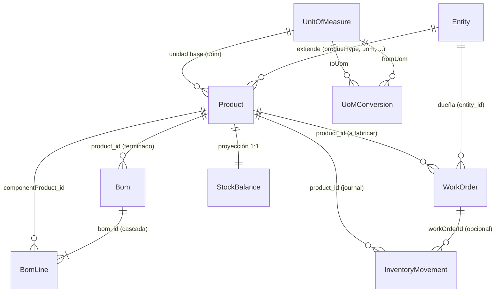
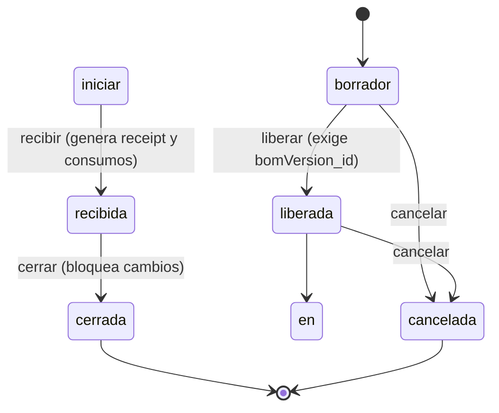
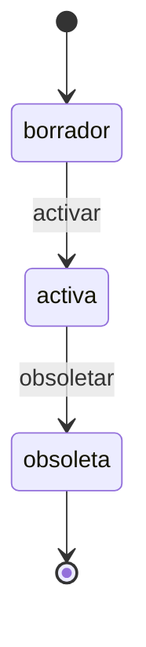
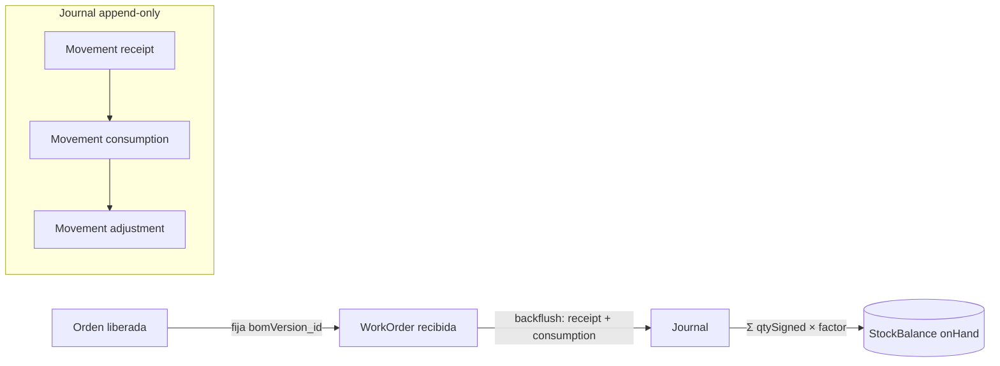

# Diagrama Entidad-Relación `_rama2`: Módulo de Manufactura y Operaciones

Compañero visual de [`data_model_rama2.md`](./data_model_rama2.md). Todas las entidades, atributos y cardinalidades de este diagrama derivan de ese documento.

## Diagrama Entidad-Relación

## Máquina de Estados — Orden de Fabricación

## Máquina de Estados — Lista de Materiales

## Flujo de Inventario (journal → saldo)

Cómo leerlo:

- **erDiagram**: relaciones y cascadas (borrar el padre elimina lo marcado con *cascada*; el historial de movimientos nunca se borra).
- **stateDiagram**: transiciones legales; cualquier otra vía se rechaza con un motivo.
- **flowchart**: invariante `saldo = Σ movimientos` y quién genera cada movimiento.
